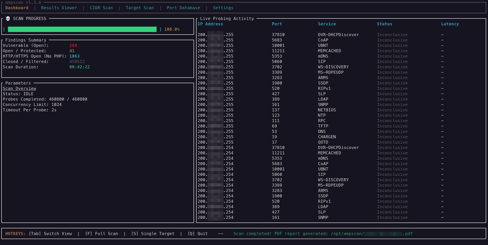
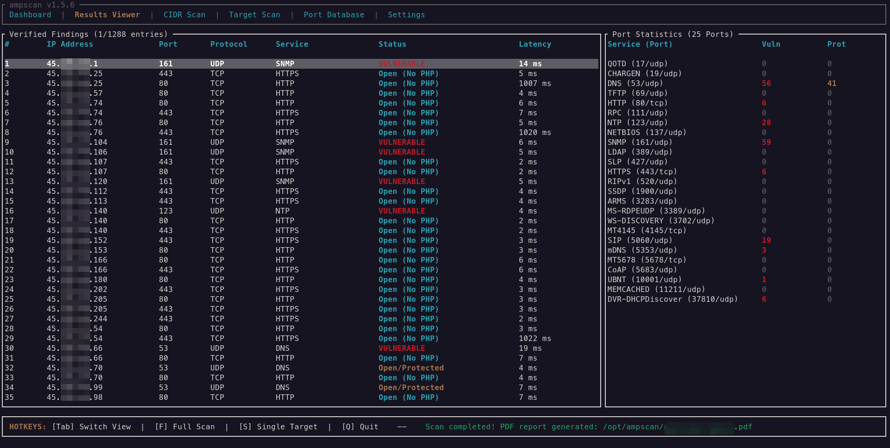
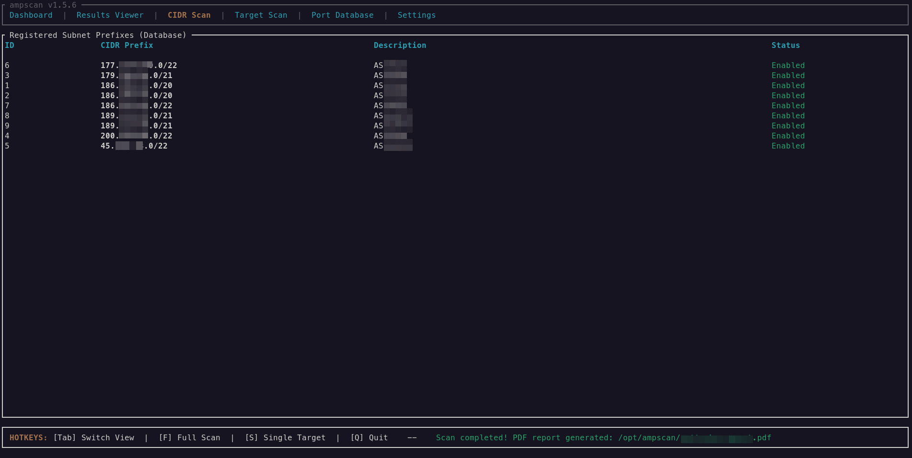
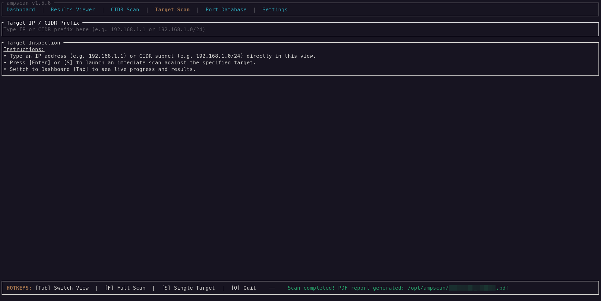
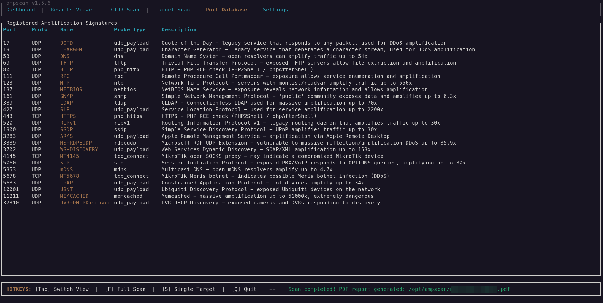
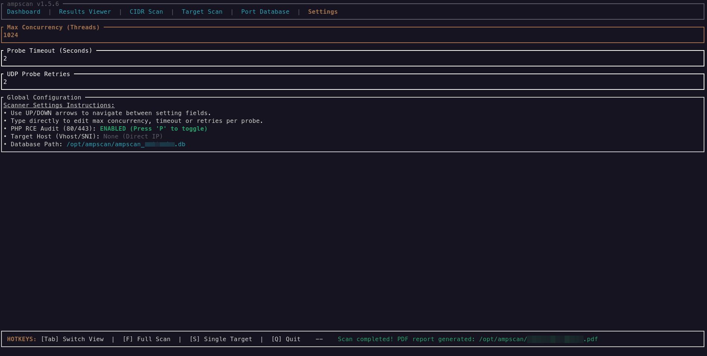
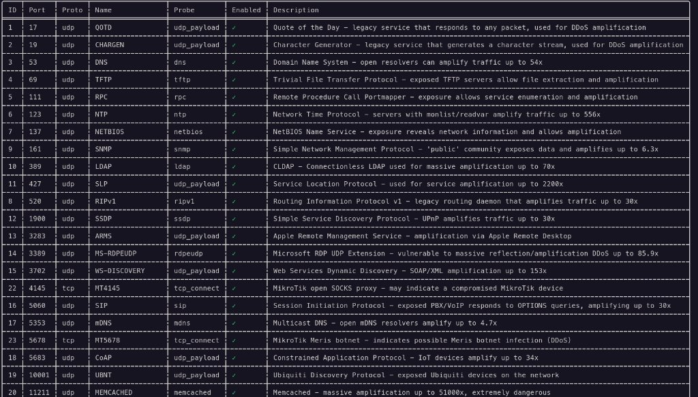
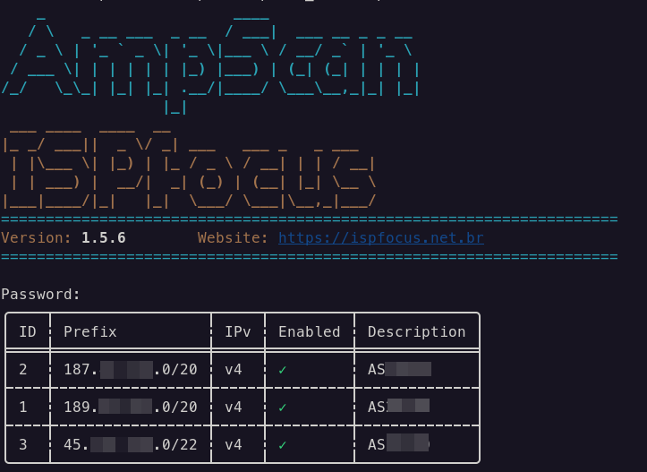
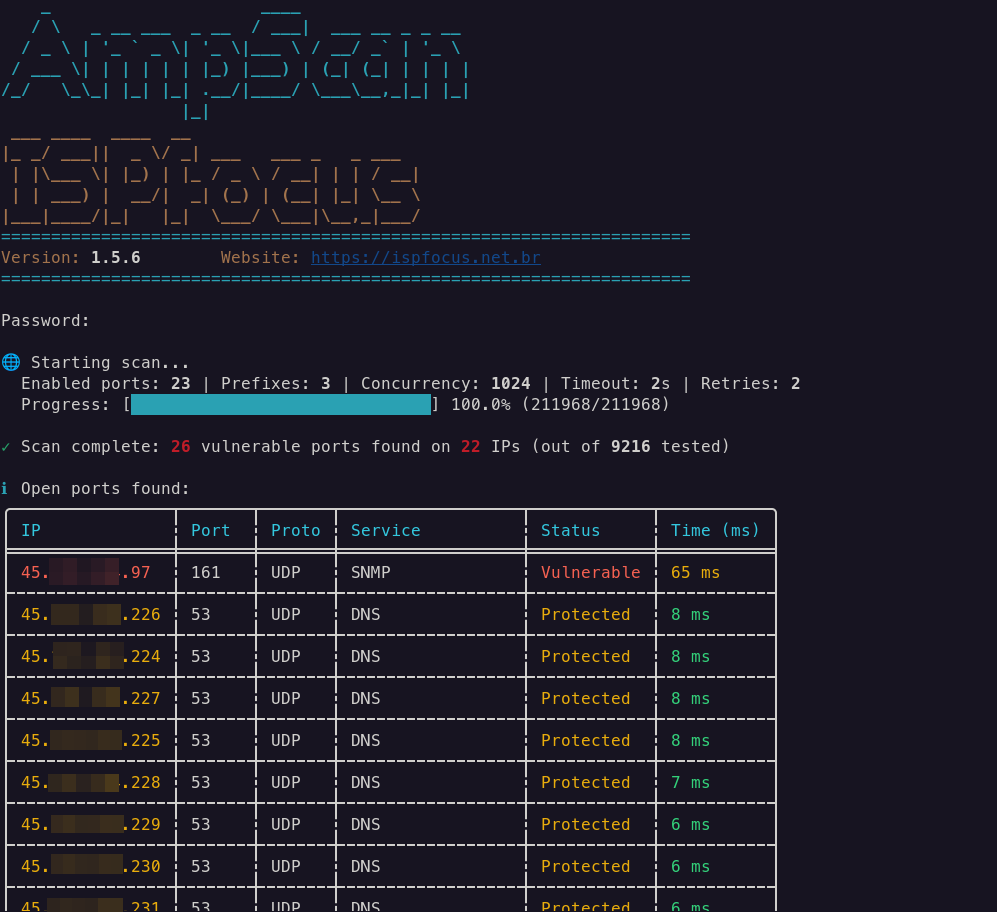

# AmpScan — Usage Manual and User Guide

**AmpScan** is a high-performance command-line (CLI) tool written in Rust, designed to audit networks and identify open and misconfigured ports that could be exploited in **DDoS amplification** attacks across IPv4 and IPv6 protocols.

---

### ☕ Support the Project

If **AmpScan** is useful for your infrastructure or security audits, consider supporting the continuous development and maintenance of the tool:

#### 🌐 Donate via PayPal (International / Credit Card)
[](https://www.paypal.com/donate/?business=7LD8SPXNF2KH2&no_recurring=0&item_name=Support+AmpScan+development&currency_code=BRL)

#### ⚡ Donate via PIX (Brazil - Instant Payment)


* **PIX Key (Email):** `gondim@gmail.com`
* **Beneficiary:** Marcelo Gondim

<details>
<summary>📋 <i>Click to reveal and copy the raw <b>PIX Copy and Paste code</b> (EMV payload)</i></summary>

```text
00020126380014br.gov.bcb.pix0116gondim@gmail.com5204000053039865802BR5914MARCELO GONDIM6014RIO DE JANEIRO62070503***6304AF6F
```
</details>

---

## 🔒 Security First

AmpScan was designed with security at rest in mind. The local SQLite database (`ampscan.db`) is **completely encrypted using SQLCipher (AES-256)**.

### Crucial Environment Variables

Before running any subcommand, you must define the following variables in your environment:

*   `AMPSCAN_DB_KEY`: **[Required]** The secret key used to encrypt/decrypt the database (a long string with more than 32 characters is recommended).
*   `AMPSCAN_DB_PATH`: *(Optional)* Custom path for the database file (default: `ampscan.db`).
*   `AMPSCAN_USER`: *(Optional)* Defines the administrator user to prevent the terminal from interactively prompting for the username on each command.
*   `AMPSCAN_PASS`: *(Optional)* Defines the administrator password to prevent the terminal from interactively prompting for the password. Extremely useful for automation/cron scans.

Environment preparation example:
```bash
export AMPSCAN_DB_KEY="a_very_secure_and_long_secret_key_for_the_db"
export AMPSCAN_USER="admin"
export AMPSCAN_PASS="my_secure_admin_password"
```

---

## 🛠️ Installation and Compilation

To compile the project on your machine (requires the Rust / Cargo toolchain installed):

```bash
# Clone the repository or navigate to the folder
cd ampscan

# Compile in Release mode for maximum scanning performance
cargo build --release
```

The compiled binary will be located at `target/release/ampscan`.

---

## 🧭 Quick Start Workflow

### 1. Initialize the Database
On the first run, initialize the database to create the encrypted schema, register the 23 default ports, and configure the initial administrator user password:

```bash
ampscan init
```
*Enter the desired username and set a strong password when prompted interactively.*

### 2. Register a Network Prefix (CIDR)
For full scanning to work, you need to register which network prefixes you own/manage to be tested:

```bash
ampscan prefix add --prefix "192.168.1.0/24" --description "Corporate Office Network"
```

### 3. List Registered Ports
Check the amplification ports registered in the system:

```bash
ampscan port list
```

### 4. Launch the Interactive TUI
Launch the Terminal User Interface to monitor scans, inspect results, or run target checks interactively:

```bash
# Mandatory: --db-path must be specified to load prefixes and ports
ampscan tui --db-path /opt/ampscan/ampscan.db -c 512 -t 2
```

---

## 🖥️ Terminal User Interface (TUI) Overview

AmpScan includes a rich **Terminal User Interface (TUI)** built with `ratatui` and `crossterm`. It provides real-time visual feedback, live progress bars, finding filters, and keyboard-driven configuration.

> ⚠️ **Requirement:** The TUI requires the `--db-path` argument to be explicitly specified upon execution. The application will not load without a valid database file.

### Quick TUI Commands:

```bash
# 1. Standard TUI launch with database
ampscan tui --db-path /path/to/ampscan.db

# 2. Custom concurrency (1024 concurrent probes, range 1-10000) and probe timeout (2s, range 1-60)
ampscan tui --db-path /path/to/ampscan.db -c 1024 -t 2

# 3. TUI launch with PHP RCE audit (--check-php) and custom Vhost/SNI (--http-host)
ampscan tui --db-path /path/to/ampscan.db --check-php --http-host www.example.com

# 4. TUI launch with automatic PDF report generation upon scan completion
ampscan tui --db-path /path/to/ampscan.db -c 512 -t 2 --pdf --recipient "SOC Team" -o /var/reports/audit.pdf
```

---

## 📸 TUI Screens & Features

### 1. Dashboard (`[Tab]` View 1)
Displays live scan metrics, a progress bar, overall statistics (Vulnerable, Open/Protected, conditional HTTP/HTTPS Open No PHP, Closed/Filtered, and live/final Scan Duration), active parameters, and a real-time stream of incoming probes.



*   **Key Controls:** Press `[F]` to start a Full CIDR scan, `[S]` for Single Target scan, and `[Q]` to quit.

### 2. Results Viewer (`[Tab]` View 2)
Dedicated split-screen viewer listing all detected findings (**VULNERABLE**, **Open/Protected**, and **Open (No PHP)**) with `Protocol` column alongside real-time **Port Statistics** (`Vuln` / `Prot`). Supports smooth free-cursor viewport scrolling.



*   **Key Controls:** Use `[UP]`, `[DOWN]`, `[PageUp]`, `[PageDown]`, `[Home]`, `[End]`, or `Ctrl+F`/`B`/`D`/`U` to navigate findings.

### 3. CIDR Scan (`[Tab]` View 3)
Shows the list of network subnets (CIDR prefixes) registered in the database, along with their active status and descriptions.



### 4. Target Scan (`[Tab]` View 4)
Allows instant scanning of a single IP address (e.g., `192.168.1.1`) or specific sub-network CIDR prefix (e.g., `192.168.1.0/24`). Real-time input validation provides green/red border feedback.



*   **Key Controls:** Type the IP/CIDR target and press `[Enter]` or `[S]` to start an immediate diagnostic scan.

### 5. Port Database (`[Tab]` View 5)
Lists all 23 DDoS amplification signatures (DNS, NTP, SNMP, Memcached, SSDP, CLDAP, etc.) and optional HTTP/HTTPS PHP RCE audit ports (`80/tcp`, `443/tcp`) dynamically synchronized with Settings.



### 6. Settings (`[Tab]` View 6)
Allows real-time tweaking of scanner runtime parameters: **Max Concurrency** (up to 10,000), **Probe Timeout** (up to 60s), **UDP Retries** (up to 10 attempts), and toggling **PHP RCE Audit (80/443)**.



*   **Key Controls:** Use `[UP]` and `[DOWN]` arrows to cycle between fields, type digits directly to edit parameters, and press `[P]` to toggle PHP RCE Audit.

---

## 📖 CLI Command Reference

### `ampscan init`
Initializes the encrypted database structure, populates it with the 23 default amplification ports, and creates the system's master user.

### Port Management (`port`)
Allows you to manage which ports and payloads will be tested during the scan:

*   **List:**
    ```bash
    ampscan --db-path ampscan.db port list
    ```
    
*   **Disable / Enable a specific port:**
    ```bash
    ampscan --db-path ampscan.db port disable <ID>
    ampscan --db-path ampscan.db port enable <ID>
    ```

### Prefix Management (`prefix`)
Defines the targets for batch scanning (accepts IPv4 and IPv6 ranges):

*   **List:**
    ```bash
    ampscan --db-path ampscan.db prefix list
    ```
    
*   **Add:**
    ```bash
    ampscan --db-path ampscan.db prefix add --prefix "2001:db8::/120" --description "IPv6 Staging Hosts"
    ```
*   **Disable / Enable:**
    ```bash
    ampscan --db-path ampscan.db prefix disable <ID>
    ampscan --db-path ampscan.db prefix enable <ID>
    ```

### User Management (`user`)
*   **Add new administrator:**
    ```bash
    ampscan --db-path ampscan.db user add --username new_admin
    ```
*   **Change password:**
    ```bash
    ampscan --db-path ampscan.db user change-password --username admin
    ```

### Running Scans (`scan`)

AmpScan offers flexible scanning modes for both network-wide audits and ad-hoc single-target investigations:

#### 1. Batch Scan Mode (`scan run`)
Tests all prefixes and ports configured in the database, or scans a manually specified CIDR prefix.

**Supported parameters:**
*   `--concurrency <N>`: Number of concurrent probes (`1..=10000`, default: `256`).
*   `--timeout <S>`: Timeout for each probe's response in seconds (`1..=60`, default: `3`).
*   `--retries <N>`: Number of retries for UDP probes (`0..=10`, default: `2`).
*   `--output <PATH>`: Name of the PDF file to be generated (default: `ampscan_report.pdf`).
*   `--prefix <CIDR>`: Manual network prefix to scan (e.g.: `192.168.1.0/24`). **Runs in Zero-DB mode if `--db-path` is omitted** (uses the built-in 23 amplification ports directly).
*   `--check-php`: Injects passive auditing for `80/tcp` (HTTP) and `443/tcp` (HTTPS) to detect critical PHP RCE vulnerabilities (PHP2Shell CVE-2026-109618/19 & phpAfterShell CVE-2026-126714).
*   `--http-host <HOST>`: Specifies a custom HTTP `Host` header and TLS Server Name Indication (SNI) for `--check-php` probes, bypassing CDN/WAF default vhosts.
*   `--pdf`: Enable automatic PDF report generation.
*   `--client-name <NAME>`: Company/client name displayed on the PDF cover.
*   `--recipient <NAME>`: PDF report recipient (e.g., manager or department name).

Database batch scan example:
```bash
ampscan --db-path ampscan.db scan run --concurrency 1024 --timeout 2 --pdf --output audit_report.pdf
```


Manual CIDR prefix scan (Zero-DB mode, no database or login required):
```bash
ampscan scan run --prefix "10.0.0.0/29" --check-php
```

#### 2. Single IP Mode (`scan single`)
Tests all amplification ports against a single target IP with live terminal feedback. **Runs in Zero-DB mode by default** — no database file, master key, or credentials needed:

```bash
# 1. Standard single IP scan across all 23 DDoS amplification ports:
ampscan scan single 1.1.1.1 --timeout 2

# 2. Single IP scan with PHP RCE audit (23 DDoS ports + 80/tcp + 443/tcp):
ampscan scan single 198.51.100.10 --check-php

# 3. Single IP scan behind CDN/WAF with custom Host header and TLS SNI:
ampscan scan single 104.21.76.221 --check-php --http-host www.example.com.br

# 4. Optional: Single IP scan using customized ports from an encrypted database:
ampscan --db-path ampscan.db scan single 1.1.1.1
```

#### 3. Passive PHP RCE Audit (`--check-php` & `--http-host`)
*   **Two-Phase Non-Intrusive Probing:** Performs a fast TCP connect (capped at `1500ms`) followed by a `HEAD / HTTP/1.1` request (`1500ms` read timeout) inspecting `X-Powered-By` and `Server` headers without sending exploit payloads.
*   **Upstream Patch Thresholds (PHP2Shell CVE-2026-109618/19 & phpAfterShell CVE-2026-126714):** Versions below `8.2.36`, `8.3.37`, `8.4.28`, `8.5.13` (and EOL branches $\le$ `8.1`) are reported as **Vulnerable**. Patched versions are reported as **Open/Protected**.
*   **No Banner (`expose_php = Off`):** Open `80/tcp` or `443/tcp` ports without an explicit PHP version header are classified as **Open (No PHP detected)** — never declared as protected.
*   **CDN / Reverse Proxy Routing (`--http-host`):** Injects the `Host` header and TLS SNI hostname (stripping optional `:port` per RFC 6066, with strict anti-CRLF validation).

---

## 📈 Understanding the Results

During each port scan, the status can be classified as:

1.  🔴 **Open (Vulnerable):** The target responded with a valid amplification payload or an affected PHP version header.
2.  🟡 **Open/Protected:** The port is open and active, but explicitly protected (e.g., DNS with recursion disabled, NTP `Mode 6` refusal `E=1`, or patched PHP $\ge 8.2.36 / 8.3.37 / 8.4.28 / 8.5.13$).
3.  🔵 **Open (No PHP detected):** Web port (`80/tcp` or `443/tcp`) is open, but no PHP version banner was exposed in HTTP headers. Excluded from `Vuln`/`Prot` counters and PDF PHP advisories.
4.  🟢 **Closed:** The host responded on at least one other port (host is alive), while this specific port yielded no response or refused connection.
5.  ⚪ **Inconclusive:** The tested host did not respond to any of the sent probes, suggesting the host might be offline or entirely blocking diagnostic traffic.

---

## 🧪 Manual Verification Commands (All 23 Amplification Ports)

Below is the complete list of standard command-line instructions to manually and independently verify any finding identified by AmpScan. Replace `<IP>` with the target host address:

| Service | Port/Proto | Amplification Factor | Manual Verification Command |
|---|---|---|---|
| **QOTD** | 17/udp | ~140x | `echo 'test' \| nc -u -w 3 <IP> 17 \| xxd` |
| **CHARGEN** | 19/udp | ~358x | `echo 'test' \| nc -u -w 3 <IP> 19 \| xxd` |
| **DNS** | 53/udp | ~54x | `dig +short -t ANY google.com @<IP>` |
| **TFTP** | 69/udp | ~60x | `tftp <IP> -c get a.pdf` |
| **RPC (Portmapper)** | 111/udp | ~28x | `rpcinfo -T udp -p <IP>` |
| **NTP** | 123/udp | ~556x | `printf '\x16\x02\x00\x01\x00\x00\x00\x00\x00\x00\x00\x00' \| nc -u -w 3 <IP> 123 \| xxd` |
| **NetBIOS** | 137/udp | ~4x | `printf '\x00\x01\x00\x00\x00\x01\x00\x00\x00\x00\x00\x00\x20CKAAAAAAAAAAAAAAAAAAAAAAAAAAAAAA\x00\x00\x21\x00\x01' \| nc -u -w 3 <IP> 137 \| xxd` |
| **CLDAP** | 389/udp | ~70x | `printf '\x30\x25\x02\x01\x01\x63\x20\x04\x00\x0a\x01\x00\x0a\x01\x00\x02\x01\x00\x02\x01\x00\x01\x01\x00\x87\x0bobjectClass\x30\x00' \| nc -u -w 3 <IP> 389 \| xxd` |
| **SLP** | 427/udp | ~2200x | `printf '\x02\x01\x00\x00\x36\x20\x00\x00\x00\x00\x00\x01\x00\x02\x65\x6e\x00\x00\x00\x15\x73\x65\x72\x76\x69\x63\x65\x3a\x73\x65\x72\x76\x69\x63\x65\x2d\x61\x67\x65\x6e\x74\x00\x07\x64\x65\x66\x61\x75\x6c\x74\x00\x00\x00\x00' \| nc -u -w 3 <IP> 427` |
| **RIPv1** | 520/udp | ~30x | `printf '\x01\x01\x00\x00\x00\x00\x00\x00\x00\x00\x00\x00\x00\x00\x00\x00\x00\x00\x00\x00\x00\x00\x00\x10' \| nc -u -w 3 <IP> 520 \| xxd` |
| **SNMP** | 161/udp | ~6.3x | `snmpget -v 2c -c public <IP> iso.3.6.1.2.1.1.1.0` |
| **SSDP** | 1900/udp | ~30x | `printf 'M-SEARCH * HTTP/1.1\r\nHost:239.255.255.250:1900\r\nST:upnp:rootdevice\r\nMan:"ssdp:discover"\r\nMX:3\r\n\r\n' \| nc -u -w 3 <IP> 1900` |
| **ARMS** | 3283/udp | ~35.5x | `printf '\x00\x14\x00\x01\x03' \| nc -u -w 3 <IP> 3283 \| xxd` |
| **MS-RDPEUDP** | 3389/udp | ~85.9x | `printf '\x00\x00\x00\x00\x01\x00\x01\x00\x12\x34\x56\x78\xb0\x04\xb0\x04' \| nc -u -w 3 <IP> 3389 \| xxd` |
| **WS-DISCOVERY** | 3702/udp | ~153x | `printf '\x3c\xaa\x3e\x0a' \| nc -u -w 3 <IP> 3702 \| xxd` |
| **SIP** | 5060/udp | ~15x - 30x | `printf 'OPTIONS sip:ping@<IP> SIP/2.0\r\nVia: SIP/2.0/UDP <IP>:5060;branch=z9hG4bK-1\r\nMax-Forwards: 70\r\nFrom: <sip:ping@<IP>>;tag=1\r\nTo: <sip:ping@<IP>>\r\nCall-ID: 1@<IP>\r\nCSeq: 1 OPTIONS\r\nContent-Length: 0\r\n\r\n' \| nc -u -w 3 <IP> 5060` |
| **mDNS** | 5353/udp | ~4.7x | `dig +short -p 5353 @<IP> -t PTR _services._dns-sd._udp.local` |
| **CoAP** | 5683/udp | ~34x | `printf '\x40\x01\x7d\x70\xbb\x2e\x77\x65\x6c\x6c\x2d\x6b\x6e\x6f\x77\x6e\x04\x63\x6f\x72\x65' \| nc -u -w 3 <IP> 5683 \| xxd` |
| **UBNT** | 10001/udp | ~30x | `printf '\x01\x00\x00\x00' \| nc -u -w 3 <IP> 10001 \| xxd` |
| **Memcached** | 11211/udp | ~51000x | `printf '\x00\x00\x00\x00\x00\x01\x00\x00stats\n' \| nc -u -w 3 <IP> 11211` |
| **DVR-DHCPDiscover** | 37810/udp | ~25x | `echo -ne '\xff' \| nc -u -w 2 <IP> 37810 \| xxd` |
| **MT4145** | 4145/tcp | Proxy / Compromised | `nc -z -v -w 3 <IP> 4145` |
| **MT5678** | 5678/tcp | Meris Botnet | `nc -z -v -w 3 <IP> 5678` |

---

## 🗺️ Project Architecture & Structural Map

AmpScan is structured into modular Rust modules adhering strictly to the **Single Responsibility Principle (SRP)**:

```text
ampscan/
├── Cargo.toml                  # Package manifest, dependencies, and platform configurations
├── CHANGELOG.md                # Project version history and detailed modification log
├── README.md                   # User guide, documentation, and architecture manual
├── src/
│   ├── main.rs                 # CLI entrypoint, banner, and command dispatcher
│   ├── lib.rs                  # Library root and public module exports
│   ├── auth.rs                 # Argon2id password hashing and secure CLI prompt helpers
│   ├── sys_limits.rs           # OS file descriptor limit management (ulimit)
│   │
│   ├── cli/                    # Command-line interface layer
│   │   ├── args.rs             # Clap parser definitions (Cli, Commands, range validators)
│   │   ├── auth_helper.rs      # Database unlocking, key zeroization & user authentication
│   │   ├── mod.rs              # Re-exports for CLI command handlers
│   │   └── commands/           # Isolated subcommand handlers
│   │       ├── init.rs         # Database schema creation and initial admin setup
│   │       ├── port.rs         # Port listing, enabling, and disabling
│   │       ├── prefix.rs       # Network prefix (CIDR) management
│   │       ├── scan.rs         # Network scan execution and terminal table formatting
│   │       └── user.rs         # Administrative user management
│   │
│   ├── db/                     # Encrypted database layer (SQLCipher AES-256)
│   │   ├── mod.rs              # Connection management, WAL mode, migrations, and lock helpers
│   │   ├── models.rs           # Relational structs (Port, Prefix, User)
│   │   ├── default_ports.rs    # Static definitions of 23 amplification ports and payloads
│   │   ├── port_repo.rs        # SQL CRUD transactions for ports
│   │   ├── prefix_repo.rs      # SQL CRUD transactions for CIDR prefixes
│   │   └── user_repo.rs        # User creation, authentication, and password updates
│   │
│   ├── scanner/                # High-concurrency network scanning engine
│   │   ├── mod.rs              # Concurrency semaphore (acquire-before-spawn) & IP expansion
│   │   ├── result.rs           # ScanReport, PortStatus, and ProbeResult models
│   │   └── probes/             # Low-level network probing
│   │       ├── http.rs         # Passive HTTP/HTTPS PHP RCE probe (--check-php & --http-host)
│   │       ├── transport.rs    # Connected UDP/TCP sockets, timeouts, and FD exhaustion detection
│   │       ├── validate.rs     # Protocol inspection (DNS/NTP/SNMP/LDAP/RPC/NetBIOS/RDPEUDP)
│   │       ├── payloads.rs     # Protocol binary payload generators and 13 unit tests
│   │       └── mod.rs          # Probe dispatcher (execute_probe)
│   │
│   ├── report/                 # Executive PDF report generator (printpdf)
│   │   ├── config.rs           # AppConfig, CompanyConfig, and config.toml resolution
│   │   ├── writer.rs           # A4 document writer, font metrics, and coordinate management
│   │   ├── text.rs             # WinAnsi character sanitization and text/command wrapping
│   │   ├── procedures.rs       # Manual verification commands dictionary for 23 ports
│   │   └── mod.rs              # High-level PDF section orchestrator (generate_pdf)
│   │
│   └── tui/                    # Interactive Terminal User Interface (Ratatui & Crossterm)
│       ├── mod.rs              # Alternate screen lifecycle and 60 FPS event loop
│       ├── app.rs              # Reactive application state and metrics indexing
│       ├── events.rs           # Keyboard event capture and input filtering
│       └── ui/                 # Modular tab view components
│           ├── mod.rs          # Layout orchestration, tabs header, and hotkey footer
│           ├── dashboard.rs    # Real-time scan gauge, metrics, and live activity table
│           ├── results.rs      # Split screen (68% findings table / 32% port statistics)
│           ├── cidr_scan.rs    # Subnet prefixes table
│           ├── single_target.rs# Reactive single-host inspection form
│           ├── port_database.rs# Registered amplification signatures table
│           └── settings.rs     # Runtime concurrency, timeout, retries, and PHP RCE controls
```

---

## 🚀 CI/CD & Release Automation (Codeberg)

This repository supports build and test automation via **Woodpecker CI** hosted on Codeberg:

* **Continuous Integration (CI):** On every `push` or `pull_request` sent to the `main` branch, the complete unit and integration test suite is executed automatically (with parallelism limited to `-j 1` to respect Codeberg's shared resource guidelines).
* **Continuous Delivery (CD):** When creating and pushing a version tag (e.g., `v1.4.8`), the pipeline compiles the binary (`ampscan`) in production mode (Release) for Linux x86_64, compresses it into a `.tar.gz` file, and attaches the final file directly to the Releases page on Codeberg.

